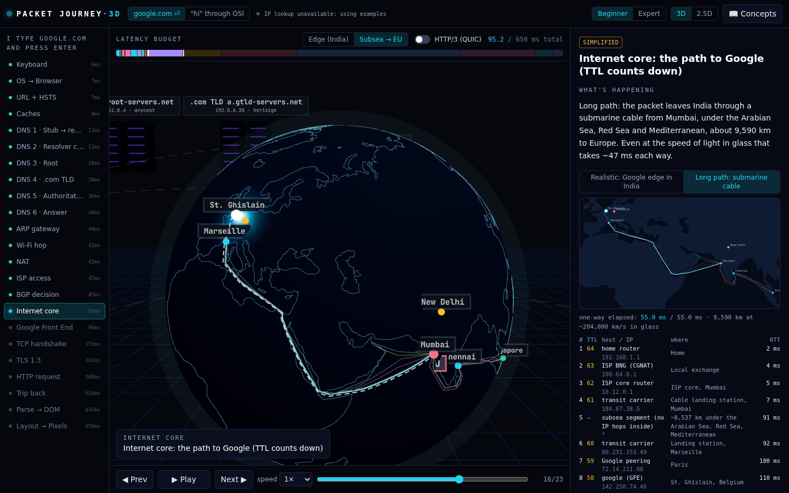
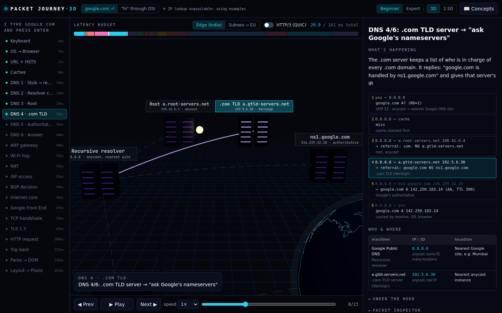
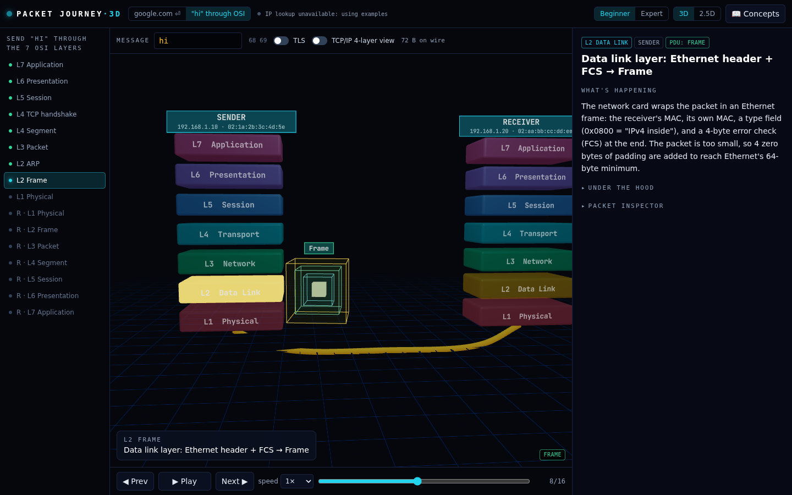
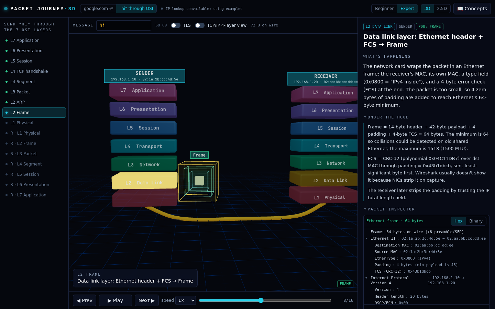
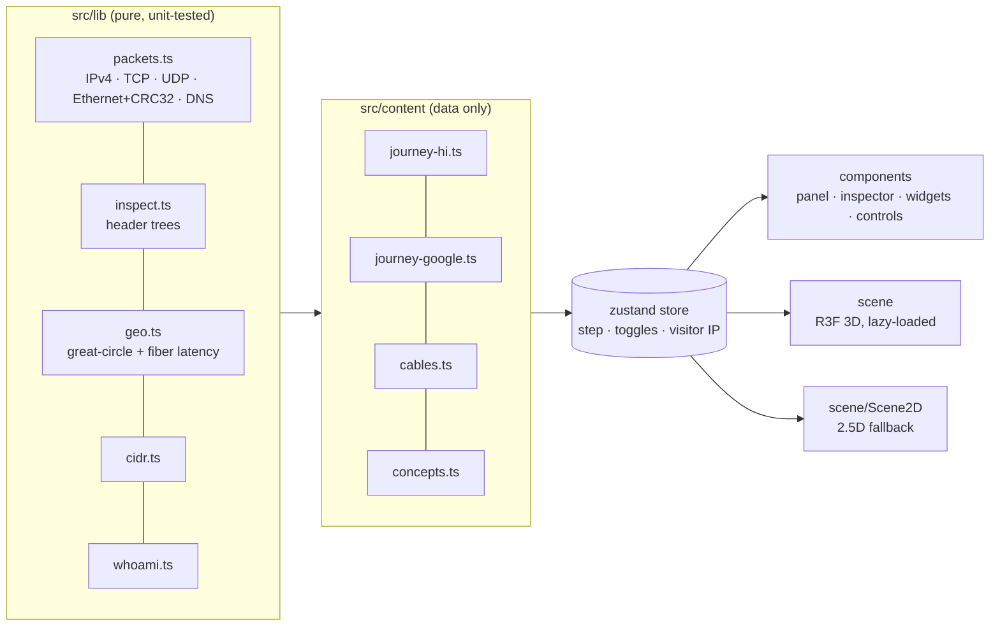
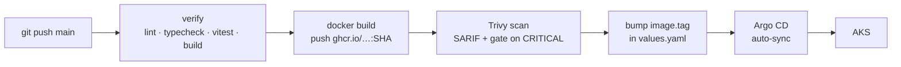

# Packet Journey 3D

An interactive 3D site that shows **exactly** what happens to your data:

1. **`google.com` ⏎**: from the key switch under your finger, through USB HID, the OS, the browser, **all 6 DNS steps** (stub → recursive resolver → root → .com TLD → Google's nameserver → answer), ARP, Wi-Fi, NAT, your ISP, BGP, the internet core (an IXP in India, or **submarine cables** to Europe on a 3D globe), Google's front end, TCP, TLS 1.3, HTTP/2 or HTTP/3, and back to pixels on your screen. A running **latency budget** shows where the milliseconds go.
2. **"hi" through the OSI model**: type any message and watch it become UTF-8 bytes, a TCP segment, an IP packet, an Ethernet frame and finally signals on copper, fiber or Wi-Fi. Then the receiver checks and strips each header.

Every header, checksum and CRC is **computed from real bytes** (see `src/lib`). Anything simplified is marked with a `simplified` tag. When you open the page it looks up **your public IP, city and ISP/ASN** and uses them in the router/NAT, ISP and BGP steps. The lookup runs in your browser via ipapi.co, nothing is stored, and you can switch it off.



| DNS hierarchy | OSI encapsulation | Packet inspector (expert) |
|---|---|---|
|  |  |  |

## Features

- 3D scenes (React Three Fiber): OSI stacks with headers wrapping the packet, a TCP handshake, ARP broadcast and line-code pulses; a 3D globe with real coastlines, 7 submarine cables landing in Mumbai/Chennai (AAE-1, SEA-ME-WE 4/6, IMEWE, BBG, i2i, TIC), IXPs, PoPs and data centers. The packet plays back at real propagation delay, slowed 40×.
- Wireshark-style inspector: an expandable header tree; click a field to highlight its bytes in hex or binary.
- "Who & where" table on every step: which machine, its IP, its role and where it physically is (8.8.8.8 anycast, a.root-servers.net, a.gtld-servers.net, ns1.google.com, Google Front End).
- Concepts drawer: encapsulation, subnet, CIDR, public vs private subnet, endpoint/socket/5-tuple, NAT/CGNAT, anycast, AS, BGP, peering vs transit, IXP, PoP, CDN, TTL, MTU/MSS, RTT and more, plus a **CIDR calculator**.
- Controls: Next/Prev/Play/Pause, speed 0.5×–3×, timeline, step list, Beginner/Expert, ←/→/Space shortcuts, deep links (`#hi-l4`, `#g-dns-root`, …), click any 3D object for an explanation.
- Mobile and low-power devices fall back to a 2.5D view (three.js is not even downloaded). Respects `prefers-reduced-motion`. Bloom switches off automatically if the GPU can't keep up.

## Architecture



Steps are typed objects (`src/content/types.ts`):

```ts
interface Step {
  id: string;              // deep link: #g-dns-root
  short: string; title: string;
  layer?: 1..7; side?: 'sender' | 'receiver' | 'wire'; pdu?: 'Data' | 'Segment' | 'Packet' | 'Frame' | 'Bits';
  focus: string;           // which 3D object the camera flies to
  what: Dyn<string>;       // plain English (Beginner)
  under: Dyn<string[]>;    // expert detail
  simplified?: string;     // shows the "simplified" tag
  widget?: Widget;         // utf8 | handshake | dns | nat | traceroute | tls | …
  hosts?: Dyn<Host[]>;     // who & where
  checks?: (c) => Check[]; // receiver checks, computed on real bytes
  inspect?: (c) => Inspection;  // header tree + bytes
  latencyMs?: (c) => number;    // latency budget contribution
}
```

`Dyn<T>` values can depend on the user's toggles (message, TLS, medium, path, QUIC, detected IP). Adding or fixing a step only touches `src/content`, never the 3D code.

## Run locally

```bash
npm ci
npm run dev            # http://localhost:5173
make ci                # lint + typecheck + tests + build
make up                # docker compose → http://localhost:8080
```

## Hosting

### GitHub Pages
`.github/workflows/pages.yml` builds with `BASE_PATH=/<repo>/` and deploys to `https://<user>.github.io/packet-journey-3d/`.
One-time setup: **Settings → Pages → Source: GitHub Actions**. For a custom domain, add it in Settings → Pages and set the repository variable `PAGES_BASE_PATH` to `/`.

### Container → AKS via Argo CD


- **Dockerfile**: multi-stage `node:22-alpine` build → `nginx:1.27-alpine` running as the `nginx` user on :8080, gzip, immutable caching for hashed assets, `no-cache` for `index.html`, and CSP / nosniff / frame / referrer / permissions headers. `/healthz` serves the probes.
- **Helm** (`deploy/helm/packet-journey`): Deployment (non-root, read-only rootfs, dropped capabilities, seccomp), Service, Ingress, HPA (CPU 70%), resource requests/limits, liveness/readiness probes.
- **Argo CD**: `kubectl apply -n argocd -f deploy/argocd/application.yaml`. CI commits the new image tag to `values.yaml`, and Argo CD syncs it to the cluster.
- AKS notes: the default `ingress.className` is the AKS app-routing add-on (`webapprouting.kubernetes.azure.com`); use `nginx` for ingress-nginx. Make the GHCR package public, or add an `imagePullSecrets` entry.

## Accuracy notes

Example addresses use private ranges or RFC 5737 documentation ranges. Root, TLD and Google nameserver IPs are real. Submarine cable routes are hand-traced approximations of public maps. Latency is modelled from great-circle distance at the speed of light in fiber (~204,000 km/s), plus typical access and queueing delays. It is an estimate, not a live measurement. Browsers cannot read your LAN IP, so that one is always an example.
