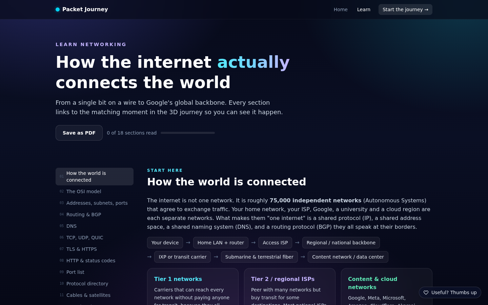
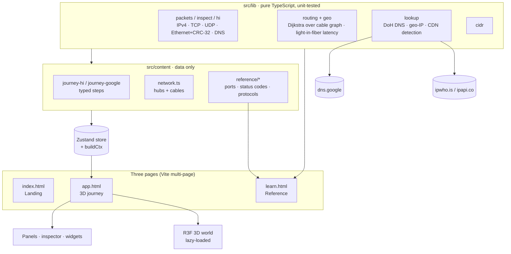
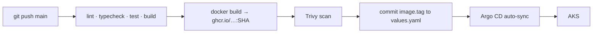

# Packet Journey

**See how the internet really works.** Type any website and follow your request from the key under your finger, through all seven OSI layers, your router, your ISP, submarine cables or satellites, to a data center and back. It runs in 3D, with real DNS, real geography and real packet bytes. A full networking reference ships alongside it.

> Built as an educational project and a DevOps portfolio piece. Everything technical is meant to be accurate; anything simplified is marked with a **simplified** tag in the app. If you spot a mistake, please [open an issue](#feedback--contributing).

| Landing | 3D journey: the backbone | Learn |
|---|---|---|
|  |  |  |

---

## What it does

### 1. Visit any website (23 steps)
`app.html?d=example.com`
- **Live lookup**: DNS-over-HTTPS (`dns.google`) resolves A/AAAA records and CNAME chains, finds the zone's nameservers and the TLD servers, and geolocates the server, its nameserver and **you** (public IP, city, ISP/ASN).
- **Keyboard → OS → browser**: key matrix, USB HID report bytes, interrupts, URL parsing, HSTS, caches.
- **All 6 DNS steps** with real packets: stub → recursive resolver → root → TLD → authoritative → answer.
- **Local network**: subnet decision (AND with the mask), ARP for the gateway, Wi-Fi, NAT table with your real public IP.
- **Access**: fiber (GPON) or **LEO / GEO satellite** with real slant-range light time.
- **BGP**: longest-prefix match and AS path from your ISP's ASN to the destination's.
- **Backbone**: Dijkstra over a model of the world's cables and IXPs. The packet rides real systems (AAE-1, SEA-ME-WE, i2i, APG, MAREA, Grace Hopper, EllaLink…) across a textured 3D Earth, timed at real light-in-glass speed. The traceroute view shows TTL counting down.
- **Destination**: CDN edge vs geo-IP origin (anycast networks are detected), load balancer, TCP handshake, TLS 1.3 (SNI, certificate chain), HTTP/2 or HTTP/3, and the trip back.
- **Rendering**: DOM, CSSOM, layout, paint, composite.
- **Trip summary**: "your request travelled 10,803 km there and 10,803 km back in ≈ 115 ms through 9 routers and 3 submarine cables".

### 2. Send a message through the 7 layers (16 steps)
`app.html#hi-l7`
Type anything ("how are you"). Watch it become UTF-8 bytes, optionally a TLS record, a TCP segment, an IPv4 packet, an Ethernet frame (padded to 64 bytes, with CRC-32) and finally signals on copper, fiber or Wi-Fi. The receiver then checks and strips each header. RFC-style header diagrams show the real field values.

### 3. Learn networking
`learn.html`
How the world is connected (tiers, peering, IXPs, RIRs) · OSI and TCP/IP with live encapsulation · addressing, subnets, NAT, IPv6, endpoints · routing (OSPF, IS-IS, BGP, anycast, ECMP, MPLS, RPKI) · DNS · TCP/UDP/QUIC (flags, states, MTU) · TLS & HTTPS · HTTP methods and **every status code** with production causes · **port list** · **protocol directory** (60+) · submarine cable anatomy (repeaters/EDFAs, power feed, branching units, landing stations, repair ships) and satellites (LEO/MEO/GEO) · how Google, Cloudflare, Meta, Netflix, AWS and Akamai run their networks · cloud and Kubernetes networking · security · troubleshooting commands · interview questions · a quiz · glossary.

### Also
Wireshark-style packet inspector (tree + hex/binary) · latency budget per step · video mode with camera follow, subtitles and optional voice narration · Beginner/Expert · deep links and share links · keyboard shortcuts (`?`) · click any 3D object for an explanation · 2.5D fallback for phones and browsers without WebGL · `prefers-reduced-motion` respected · "Save as PDF" for the reference.

---

## Architecture



Full walkthrough of every module: **[docs/ARCHITECTURE.md](docs/ARCHITECTURE.md)**.

### Libraries and why

| Library | Why it's here |
|---|---|
| **React 19 + TypeScript (strict)** | Component model for a UI with many linked panels; strict types keep the step schema and packet code honest. |
| **Vite** | Fast dev server; multi-page build (landing / app / learn); code-splits the 3D bundle so it loads only when needed. |
| **three.js** | WebGL rendering of the Earth, models and lines. |
| **@react-three/fiber** | Lets the 3D scene be written as React components driven by the same store as the UI. |
| **@react-three/drei** | Battle-tested helpers: OrbitControls, Line, Stars, RoundedBox, Billboard, SDF `Text`, PerformanceMonitor. |
| **@react-three/postprocessing** | Bloom and vignette for the "network operations center" look (switched off automatically on slow GPUs). |
| **Zustand** | Tiny global store; components and the R3F tree subscribe to exactly the slices they need. |
| **Framer Motion** | Side-panel and drawer transitions. |
| **Tailwind CSS v4** | Utility styling with a small custom theme; no CSS framework runtime. |
| **topojson-client + world-atlas** | Natural Earth coastlines for the flat SVG map. |
| **@fontsource/jetbrains-mono** | Bundled font for 3D text (troika needs WOFF; no third-party font CDN). |
| **Vitest** | Unit tests for checksums, CRC, DNS, routing, CIDR, lookup parsing, and content. |
| **ESLint + typescript-eslint** | Lint gate in CI. |

**Data sources (all requests come from the visitor's browser):** `dns.google` (DNS-over-HTTPS JSON API), `ipwho.is` with `ipapi.co` fallback (geo-IP), NASA Blue Marble / Black Marble imagery (public domain, bundled), Natural Earth (public domain). Nothing is stored server-side: there are no accounts, no cookies and no analytics.

---

## Run locally

```bash
npm ci
npm run dev        # http://localhost:5173  (landing), /app.html, /learn.html
make ci            # lint + typecheck + tests + build
make up            # production image via docker compose → http://localhost:8080
```

## Deploy

### GitHub Pages
`.github/workflows/pages.yml` builds with `BASE_PATH=/<repo>/` and deploys on every push to `main`.
One-time setup: **Settings → Pages → Source: GitHub Actions**. For a custom domain, add it there and set the repository variable `PAGES_BASE_PATH` to `/`.

### Container → AKS with Argo CD

- **Docker**: multi-stage `node:22-alpine` → `nginx:1.27-alpine`, non-root on :8080, gzip, immutable caching for hashed assets, CSP and security headers, `/healthz`.
- **Helm** (`deploy/helm/packet-journey`): Deployment (read-only root FS, no capabilities, seccomp, probes), Service, Ingress (AKS app routing or ingress-nginx), HPA, resource limits.
- **Argo CD**: `kubectl apply -n argocd -f deploy/argocd/application.yaml`.

---

## Accuracy notes

- Packet bytes, checksums, CRC-32, DNS messages and header layouts are exact and unit-tested.
- DNS answers, nameservers, TLD servers and geo-IP are **live**. Geo-IP shows where an IP block is *registered*, which is often wrong for anycast/CDN networks; the app explains this and lets you switch between "edge" and "geo-IP".
- Cable routes are hand-traced approximations of public maps; the backbone graph is a simplified model, not a live trace. Hop IPs come from documentation ranges.
- Latency = great-circle distance at the speed of light in fiber plus typical access, Wi-Fi, satellite and server delays. It is a model, not a measurement.
- Browsers cannot see your LAN, so the private IP and MAC addresses are examples.

## Feedback & contributing

This project exists to make networking understandable for everyone, from students to senior engineers. **Corrections, feedback and suggestions are very welcome**:

- Found something technically wrong or oversimplified? Open an issue with the step id (e.g. `#g-dns-auth`) and a source.
- Ideas for new steps, protocols, cables or visualisations? Open an issue or a pull request. Content lives in `src/content/` and rarely needs 3D changes.
- If it helped you, a star on the repo is appreciated.

## Credits

NASA Visible Earth (Blue Marble, Black Marble) imagery · Natural Earth via world-atlas · cable information from public sources such as TeleGeography's Submarine Cable Map · RFCs from the IETF.
