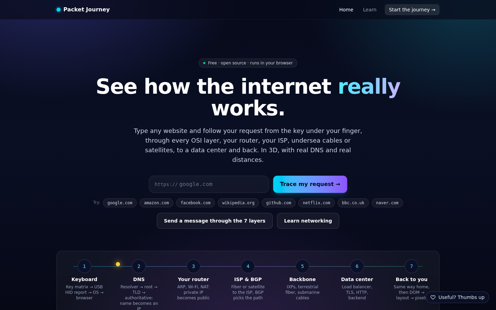
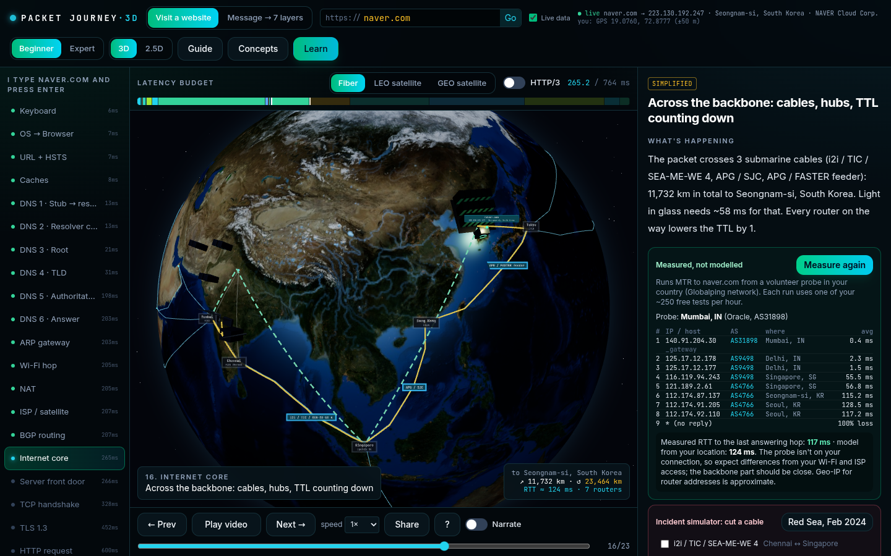
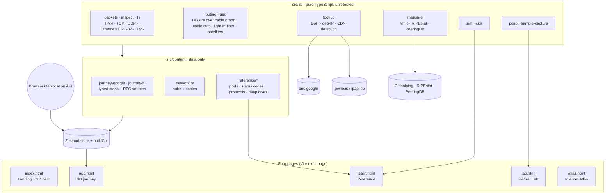
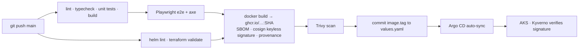

<p align="center"></p>

# Packet Journey

**See how the internet really works.** Type any website and follow your request from the key under your finger, through all seven OSI layers, your router and ISP, across submarine cables or satellites, to a data center and back. It's drawn on a 3D Earth, starts from your real location, and uses real DNS, real packet bytes and real measurements. A complete networking reference and a packet-capture lab come with it.

> An educational project and a DevOps portfolio piece. Every technical claim aims to be accurate and links to its RFC or spec; anything simplified carries a **simplified** tag. Spotted a mistake? Please [open an issue](#feedback--contributing).

| Landing | The journey (measured vs modelled) | Learn |
|---|---|---|
|  |  |  |

---

## What's inside

### 1. Visit any website (23 steps): `app.html`
- **Starts where you are.** With your permission, the browser's GPS puts you exactly on the globe; otherwise an IP-based estimate or an example location. Coordinates never leave the page.
- **Live lookups**: DNS-over-HTTPS resolves A/AAAA and CNAME chains, finds the zone's nameservers and the TLD servers, and geolocates the server, its nameserver and you (ISP + ASN).
- **Keyboard → OS → browser**: key matrix, USB HID report bytes, interrupts, URL parsing, HSTS, caches.
- **All 6 DNS steps** with real packets: stub → recursive resolver → root → TLD → authoritative → answer.
- **Local network**: subnet decision, ARP for the gateway, Wi-Fi, NAT with your public IP.
- **Access**: fiber (GPON), LEO satellite or GEO satellite, with real slant-range light time.
- **BGP**: longest-prefix match, AS path, plus **live** prefix, origin AS, RPKI validity (RIPEstat) and IXP presence (PeeringDB).
- **Backbone**: Dijkstra over a model of ~30 hubs and named submarine cables (AAE-1, SEA-ME-WE, i2i, APG, FASTER, MAREA, Grace Hopper, EllaLink, 2Africa…), animated at the real speed of light in glass. TTL counts down in a traceroute view.
- **Measured, not modelled**: one click runs a **real MTR** from a probe in your country (Globalping) and draws it on the globe next to the model. Mumbai → naver.com: model 124 ms, measured 117 ms.
- **Incident simulator**: cut submarine cables (one-click "Red Sea, February 2024" preset) and watch traffic reroute or fail.
- **Destination**: CDN edge vs geo-IP origin (anycast networks detected by operator or CDN CNAME), load balancer, TCP, TLS 1.3, HTTP/2 or HTTP/3, the trip back, rendering, and a **trip summary** ("travelled 11,732 km each way, ≈124 ms round trip, through 7 routers and 3 submarine cables").

### 2. A message through the 7 layers (16 steps): `app.html#hi-l7`
Type anything ("how are you"). It becomes UTF-8 bytes, optionally a TLS record, a TCP segment, an IPv4 packet and an Ethernet frame (padded to 64 bytes, CRC-32), then signals on copper, fiber or Wi-Fi. The receiver then checks and strips each header. RFC-style header diagrams show the real field values.

### 3. Learn networking: `learn.html`
How the world is connected (tiers, peering, IXPs, RIRs) · OSI and TCP/IP with live encapsulation · addressing, subnets/CIDR calculator, NAT, IPv6, endpoints · routing (OSPF, IS-IS, BGP, anycast, ECMP, MPLS, RPKI) with a **BGP hijack demo** · DNS · TCP/UDP/QUIC with a **loss lab** (HTTP/2 head-of-line blocking vs HTTP/3) and a **congestion-window chart** · TLS & HTTPS · HTTP methods and **every status code** with real-world causes · **110 ports** · **60+ protocols** · **25 in-depth protocol guides** (how it works, format, security, common problems, commands) · submarine cable anatomy (repeaters/EDFAs, power feed, branching units, landing stations, repair ships) and satellites · how Google, Cloudflare, Meta, Netflix, AWS and Akamai run their networks · cloud networking · security · troubleshooting commands · interview questions · quiz · glossary. "Save as PDF" included.

### 4. Packet Lab: `lab.html`
Drop a Wireshark/tcpdump **.pcap or .pcapng**. It is decoded entirely in the browser: Ethernet, VLAN, Linux cooked, ARP, IPv4/IPv6, ICMP, TCP, UDP, DNS, HTTP and TLS records. You get a packet list, a layer tree with hex, protocol hierarchy, top conversations, DNS lookups, TCP handshake RTTs and retransmissions. A sample capture can be loaded or downloaded to open in Wireshark.

### 5. Internet Atlas: `atlas.html`
The internet by the numbers, every figure linked to its source and date: people online, submarine cables (systems, total km, longest), international bandwidth, Starlink, data centers and hyperscale sites, IXPs and facilities, routing-table size and number of networks, IPv6 adoption, domains, TLDs, root server instances, websites, live per-second counters (HTTP requests, DNS queries, emails, searches), cloud and web-server market share, the biggest edge networks and Tier-1 carriers.

### 6. Everything else
- **Who's who**: the top 20 cloud providers, Indian and global ISPs and carriers, networking/security vendors, CDNs and exchanges, with logos and main ASNs (Atlas page).
- **Real cable globe**: all 734 submarine cables and 1,929 landing stations from TeleGeography, glowing on a night-side Earth with light pulses flowing along each cable.
- **Your connection, measured**: real DNS/TCP/TLS/first-byte timings and HTTP version of your own page load, from the browser's Navigation Timing API.
- **Ctrl+K search** across steps, ports, status codes, protocols, guides, glossary, facts and companies.
- **Network calculators**: bandwidth-delay product, transfer time, distance → latency.
- **Videos & reading**: 38 verified videos (Kurose, Computerphile, Ben Eater, Practical Networking, Chris Greer…), 18 books/courses, 7 professional tools.
- **Copy as Markdown** on every Learn section and a full-guide Markdown download.

### Also
Wireshark-style inspector · latency budget · video mode (camera follows the packet, subtitles, optional voice) · Beginner/Expert · deep and share links · keyboard shortcuts (`?`) · first-visit guide · per-step RFC sources · 2.5D fallback for phones and browsers without WebGL · reduced-motion support · a **Live data** switch that turns off every outside request.

---

## Architecture



The full walkthrough of every module is in **[docs/ARCHITECTURE.md](docs/ARCHITECTURE.md)**. How it compares to existing tools: **[docs/COMPARISON.md](docs/COMPARISON.md)**.

### Libraries and why

| Library | Why |
|---|---|
| **React 19 + TypeScript (strict)** | Many linked panels sharing one state; strict types keep the step schema and packet code honest. |
| **Vite** | Fast dev server, multi-page build, code-splitting so 3D loads only when needed. |
| **three.js + @react-three/fiber + drei** | The 3D Earth, models and lines as React components driven by the same store as the UI. |
| **@react-three/postprocessing** | Bloom/vignette, switched off automatically on slow GPUs. |
| **Zustand** | Tiny store; components and the 3D tree subscribe to exactly what they need. |
| **Framer Motion** | Panel and drawer transitions. |
| **Tailwind CSS v4** | Utility styling with a small theme; no CSS framework runtime. |
| **Chakra Petch + Inter + JetBrains Mono (fontsource)** | Square display face for headings, Inter for reading, mono for bytes; all bundled, no font CDN. |
| **topojson-client + world-atlas** | Natural Earth coastlines for the flat map. |
| **Vitest** | 51 unit tests: checksums, CRC, DNS, routing, cable cuts, satellites, CIDR, lookups, measurements, pcap parsing, simulations, content. |
| **Playwright + axe-core** | End-to-end tests of every journey step and accessibility checks in CI. |
| **ESLint + typescript-eslint** | Lint gate. |

**Submarine cable data** (`public/data/cables.json`) is derived from the [TeleGeography Submarine Cable Map](https://www.submarinecablemap.com/) under **CC BY-NC-SA 3.0** (attribution, non-commercial, share-alike); regenerate it with `scripts/build-cable-data.py`. **Logos** come from [Simple Icons](https://simpleicons.org/) (CC0 icon data); trademarks belong to their owners.

**Data sources (requests come from the visitor's browser; nothing is stored server-side):** dns.google (DNS-over-HTTPS), ipwho.is / ipapi.co (geo-IP), Globalping (MTR), RIPEstat (routing/RPKI), PeeringDB (peering), NASA Blue Marble / Black Marble (public-domain imagery, bundled), Natural Earth (bundled). The **Live data** switch disables all of them.

---

## Run locally

```bash
npm ci
npm run dev          # http://localhost:5173  (landing) · /app.html · /learn.html · /lab.html · /atlas.html
make ci              # lint + typecheck + unit tests + build
npm run e2e          # Playwright end-to-end + accessibility (after npx playwright install chromium)
make up              # production container via docker compose → http://localhost:8080
```

## Deploy

### GitHub Pages
`.github/workflows/pages.yml` builds with the right base path and deploys on every push to `main`. One-time setup: **Settings → Pages → Source: GitHub Actions**. For a custom domain, add it there and set repository variables `PAGES_BASE_PATH=/` and `SITE_URL=https://your.domain/`.

### Container → AKS with Argo CD

- **Docker**: multi-stage `node:22-alpine` → `nginx:1.27-alpine`, non-root on :8080, gzip, immutable caching, strict CSP and security headers, `/healthz`, internal `stub_status`.
- **Helm** (`deploy/helm/packet-journey`): Deployment (read-only root FS, no capabilities, seccomp, probes), Prometheus exporter sidecar, Service, Ingress, HPA, PodDisruptionBudget, optional ServiceMonitor.
- **Supply chain**: SPDX SBOM, cosign keyless signing and SBOM attestation via GitHub OIDC, Trivy gate.
- **Policy** (`deploy/policies/kyverno.yaml`): non-root/read-only, no `:latest`, resource limits, only images signed by this repo's workflow.
- **Infrastructure** (`infra/terraform`): AKS with Azure CNI Overlay + Cilium, workload identity, managed ingress, Log Analytics, and Argo CD with the app's Application.
- **Observability** (`deploy/grafana`): dashboard for request rate, connections, CPU and memory.

---

## Accuracy notes

- Packet bytes, checksums, CRC-32, DNS messages, header layouts and pcap parsing are exact and unit-tested.
- DNS answers, nameservers, TLD servers, geo-IP, BGP origin, RPKI and the optional MTR are **live**. Geo-IP places anycast/CDN addresses where they're *registered*; the app explains this and offers "edge" vs "geo-IP".
- Cable routes are hand-traced approximations of public maps; the backbone is a simplified graph. Latency is a model (distance at the speed of light in fiber plus typical access delays); the real MTR is there to compare.
- Browsers can't see your LAN, so private IPs and MAC addresses are examples.

## Feedback & contributing

Built to make networking understandable, from students to senior engineers. **Corrections, feedback and suggestions are very welcome**:
- Something technically wrong or oversimplified? Open an issue with the step id (e.g. `#g-dns-auth`) and a source.
- Ideas for new steps, protocols, cables or visualisations? Content lives in `src/content/` and rarely needs 3D changes.
- If it helped you, a star on the repo is appreciated.

## Credits

NASA Visible Earth (Blue Marble, Black Marble) · Natural Earth via world-atlas · TeleGeography's Submarine Cable Map (cable routes, approximated) · Globalping, RIPE NCC (RIPEstat) and PeeringDB for open measurement and routing data · the IETF RFCs.
